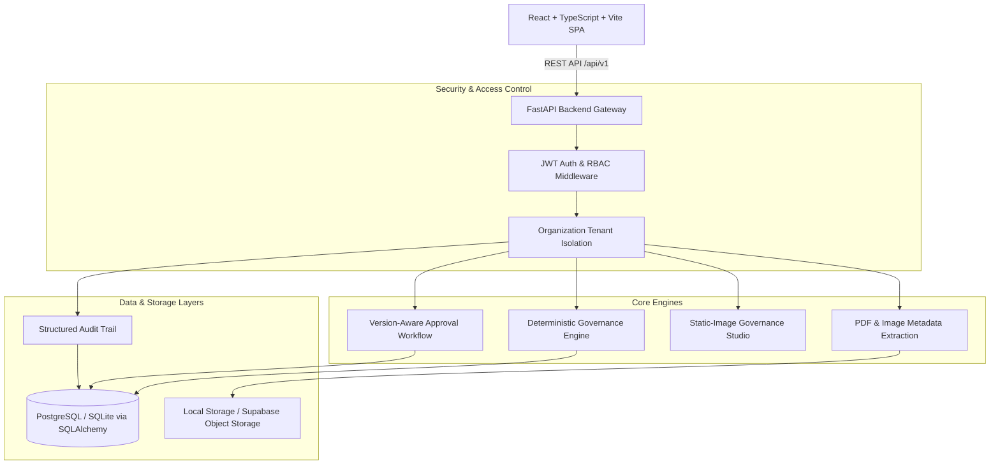

# Inkloom AI — System Architecture & Technical Specification

## 1. Executive Summary
**Inkloom AI** is a standalone pre-publication brand-governance and content-integrity platform. It provides enterprise marketing and compliance teams with deterministic rule validation, version-aware human review, and immutable audit trails.

The platform ensures that newly created marketing content strictly adheres to verified brand guidelines and product knowledge facts before publication sign-off.

---

## 2. System Architecture

---

## 3. Technology Stack

| Layer | Technology | Rationale |
|---|---|---|
| **Frontend** | React 19, TypeScript, Vite | Fast, typed, responsive SPA with instant client-side transitions |
| **Icons & Design** | Lucide React, Custom Dark Design System | Clean, high-contrast accessible interface tailored for compliance audits |
| **Backend** | Python 3.12, FastAPI, Pydantic v2 | High-throughput asynchronous REST API with strict request/response validation |
| **ORM & Migrations**| SQLAlchemy 2.0, Alembic | Declarative database models with automated schema versioning |
| **Database** | PostgreSQL 18 (with SQLite fallback) | ACID transactions, explicit foreign keys, unique constraints, and indexes |
| **Document Extraction**| PyPDF, Pillow (PIL) | Real on-disk PDF text extraction and image metadata inspection |
| **Security & Auth** | Native Bcrypt, JWT (HS256), RBAC | Strict backend authorization on every protected route |

---

## 4. Role-Based Access Control (RBAC) & Tenant Isolation

Inkloom AI enforces four distinct roles:

1. **Organization Administrator (`org_admin`)**:
   - Manages organization settings and members.
   - Assigns permitted roles.
   - Views complete workspace audit logs.
   - *Security Constraint:* Cannot approve content merely because they are an administrator.
2. **Knowledge Reviewer (`knowledge_reviewer`)**:
   - Uploads brand guidelines, product knowledge, and assets.
   - Inspects newly extracted candidate rules and facts.
   - Approves, rejects, or deprecates knowledge records.
   - *Critical Rule:* Newly uploaded documents start in `pending_review`. Uploading never automatically approves contents.
3. **Content Creator (`content_creator`)**:
   - Authors drafts and runs deterministic governance checks.
   - Inspects explainable findings and source citations.
   - Revises content (creating new immutable versions).
   - Submits versions for approval.
   - *Security Constraint:* Cannot approve their own content.
4. **Approval Manager (`approval_manager`)**:
   - Inspects the exact submitted version, checksum, and findings.
   - Records formal decisions (`approved`, `rejected`, `changes_requested`).
   - Issues the official label: **"Approved — Ready to Publish"**.
   - *Security Constraint:* Decisions are permanently locked to the submitted version.

---

## 5. Core Data Models

- **`Organization`**: Workspace boundary for all entities.
- **`User` & `OrganizationMembership`**: Managed identity and role assignment.
- **`Brand`**: Brand container scoped to organization.
- **`KnowledgeSource`**: Uploaded guidelines or asset container (`pending_review` by default).
- **`KnowledgeRule`**: Brand rules (prohibited words, mandatory terminology, tone). Only `approved` rules are evaluated by the governance engine.
- **`KnowledgeFact`**: Product specifications, nutritional values, and claims. Includes `valid_from` and `valid_until` timestamps.
- **`BrandAsset`**: Logos, product images, and campaign creatives with resolution, aspect ratio, color mode, and clearance specs.
- **`ContentItem`**: Marketing draft container tracking `current_version_num` and lifecycle state.
- **`ContentVersion`**: Immutable revision record with body text, author, timestamp, and SHA-256 checksum.
- **`GovernanceRun` & `GovernanceFinding`**: Audit record of deterministic check runs with categories, severity, explainable text excerpts, and source citations.
- **`ApprovalSubmission` & `ApprovalDecision`**: Version-locked approval records.
- **`AuditEvent`**: Organization-level governance activity trail.
