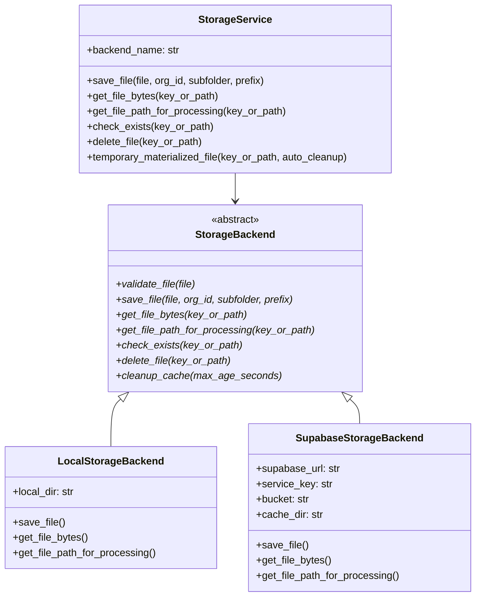
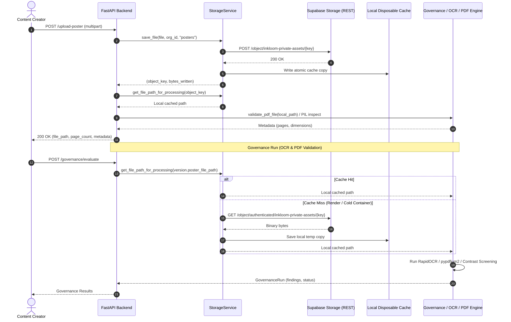

# Milestone 5I.4 — Private Supabase Storage Adapter and Durable Asset Persistence

**Project:** Inkloom.AI Brand Governance & Content Integrity Platform  
**Workspace:** `E:\CodeStar30`  
**Frontend target:** Firebase Hosting (`ad-governance`)  
**Backend target:** Render Free Python Web Service / Google Cloud Run  
**Database:** Existing Supabase PostgreSQL (`db.qwvqifqnyurlqewkrsiw.supabase.co`)  
**Durable Storage:** Private Supabase Storage Bucket (`inkloom-private-assets`)  
**Current Milestone Status:** `IMPLEMENTED — LIVE STORAGE VERIFICATION PENDING`

---

## 1. Executive Summary

Milestone 5I.4 establishes durable, private object storage persistence for Inkloom.AI by extending `StorageService` to support private Supabase Storage (`STORAGE_BACKEND=supabase`) alongside the local filesystem backend (`STORAGE_BACKEND=local`).

All upstream governance, local OCR, multi-page PDF processing, accessibility contrast evaluation, authentication, correction suggestions, versioning, and analytics workflows have been preserved without regressions.

---

## 2. Storage Contract Audit

An exhaustive audit of the existing codebase was conducted before architectural changes were committed:

| Call Site / Component | Previous Invocation & Contract | Filesystem & Path Assumptions | Adapted Behavior in M5I.4 |
| :--- | :--- | :--- | :--- |
| `backend/app/services/storage.py` | `save_file(file, org_id, subfolder)` returning `Tuple[str, int]` | Wrote directly to `LOCAL_STORAGE_DIR/{org_id}/{subfolder}/{safe_filename}` | Abstracted into `StorageBackend` with `LocalStorageBackend` and `SupabaseStorageBackend` |
| `app/api/v1/content.py:upload_poster` | `await storage_service.save_file(...)` -> `dest_path, bytes` | Called `pdf_service.validate_pdf_file(dest_path)` and `Image.open(dest_path)` directly | Uses `storage_service.get_file_path_for_processing(dest_path)` to ensure local availability; cleans up on failure |
| `app/api/v1/content.py:get_version_poster` | Checked `if not os.path.exists(version.poster_file_path)` | Returned `FileResponse(path=version.poster_file_path)` | Uses `storage_service.check_exists()` and `get_file_path_for_processing()`; serves via authenticated backend |
| `app/api/v1/content.py:get_version_pdf_pages` | Inspected `version.poster_file_path` | Called `pdf_service.validate_pdf_file(version.poster_file_path)` | Uses `storage_service.get_file_path_for_processing()` to read PDF structure safely |
| `app/api/v1/knowledge.py:upload_knowledge_document` | `await storage_service.save_file(...)` -> `file_path, size` | Passed `file_path` to `extract_pdf_text_and_candidates` and `extract_image_metadata` | Materializes local path before running PDF extraction and image metadata checks |
| `app/api/v1/knowledge.py:reprocess_knowledge_source` | Checked `if not os.path.exists(source.file_path)` | Passed `source.file_path` to extraction | Uses `storage_service.check_exists()` and `get_file_path_for_processing()` |
| `app/api/v1/knowledge.py:get_brand_asset_image` | Checked `if not os.path.exists(asset.file_path)` | Returned `FileResponse(asset.file_path)` | Checks existence and materializes asset safely via `storage_service` |
| `app/services/governance_engine.py` | Checked `if os.path.exists(version.poster_file_path)` | Read header `%PDF-`, called OCR, called `image_governance.evaluate_poster_for_governance` | Uses `storage_service.check_exists()` and `get_file_path_for_processing()` for OCR, contrast, and PDF governance |
| `app/services/image_governance.py` | `if not os.path.exists(logo_asset.file_path)` | Called `cv2`/template matching against local path | Resolves `logo_asset.file_path` through `storage_service.get_file_path_for_processing()` |
| `app/models/content.py:calculate_checksum` | Read file bytes if `os.path.exists(poster_file_path)` | Fell back to hashing path string if local file was missing | Resolves actual file bytes via `storage_service.get_file_path_for_processing()` so SHA-256 matches exact stored bytes |

---

## 3. Storage Adapter Architecture & Configuration

### 3.1 Dual-Backend Design

`StorageService` implements the Strategy pattern using an abstract base class `StorageBackend`:



### 3.2 Configuration Parameters

Configuration is managed via `app.config.Settings`:

| Environment Variable | Default Value | Description | Sensitivity |
| :--- | :--- | :--- | :--- |
| `STORAGE_BACKEND` | `local` | Active storage backend: `local` or `supabase` | Non-sensitive |
| `LOCAL_STORAGE_DIR` | `./storage_data` | Directory for local storage or disposable Supabase cache | Non-sensitive |
| `SUPABASE_URL` | `None` | Supabase project URL (e.g., `https://qwvqifqnyurlqewkrsiw.supabase.co`) | Non-sensitive |
| `SUPABASE_SERVICE_KEY` | `None` | Privileged service role key (bypasses RLS for backend operations) | **CRITICAL SECRET — Backend Only** |
| `SUPABASE_STORAGE_BUCKET` | `inkloom-private-assets` | Target private storage bucket | Non-sensitive |

> [!CAUTION]
> `SUPABASE_SERVICE_KEY` must never be committed to Git, bundled into React frontend builds, or printed in logs. Supabase service-role keys bypass row-level security and must strictly reside in server-side environment variables.

---

## 4. Bucket Setup & Access-Control Requirements

### 4.1 Target Bucket Specification

- **Bucket Name:** `inkloom-private-assets`
- **Visibility:** **Private** (`public = false`)
- **Allowed MIME Types:** PDF (`application/pdf`), Images (`image/png`, `image/jpeg`, `image/webp`, `image/svg+xml`), Text (`text/plain`)
- **File Size Limit:** 25 MB (`MAX_FILE_SIZE_BYTES = 26214400`)

### 4.2 Safe Bucket Creation Procedure

Inspection of the remote Supabase database via MCP revealed that `storage.buckets` does not yet contain `inkloom-private-assets`.

To safely initialize the bucket in the Supabase project without exposing credentials or altering live settings prematurely:

#### Option A: Via Supabase Dashboard (Recommended)
1. Log in to [Supabase Dashboard](https://supabase.com/dashboard/project/qwvqifqnyurlqewkrsiw).
2. Navigate to **Storage** -> **New Bucket**.
3. Set **Bucket Name**: `inkloom-private-assets`.
4. Leave **Public Bucket** unchecked (`false`).
5. Set file size limit to **25 MB**.
6. Save bucket.

#### Option B: Via SQL Editor
```sql
INSERT INTO storage.buckets (id, name, public, file_size_limit, allowed_mime_types)
VALUES (
    'inkloom-private-assets',
    'inkloom-private-assets',
    false,
    26214400,
    ARRAY['application/pdf', 'image/png', 'image/jpeg', 'image/webp', 'image/svg+xml', 'text/plain']
)
ON CONFLICT (id) DO NOTHING;
```

---

## 5. Object-Key & Tenant-Isolation Strategy

### 5.1 Object Key Structure

Original files uploaded to Supabase Storage follow a deterministic, tenant-partitioned naming scheme:

`{organization_id}/{subfolder}/{version_id}_{safe_filename}`

Examples:
- Version 1 poster: `org-acme-corp/posters/v1_summer_ad.png`
- Version 2 PDF creative: `org-acme-corp/posters/v2_brand_deck.pdf`
- Knowledge guideline: `org-acme-corp/knowledge/brand_guide_2026.pdf`

### 5.2 Filename Sanitization & Path Traversal Rejection

All filenames pass through `sanitize_filename()` before key construction:
- Directory traversal sequences (`../`, `..\`) are stripped.
- Control characters and null bytes (`\x00`, `\x1b`) are removed.
- Slashes (POSIX `/` and Windows `\`) are stripped to isolate the pure basename.
- Leading dots are removed to prevent hidden files or traversal.
- Whitespace and illegal characters are replaced with underscores.

### 5.3 Tenant Isolation Validation

Tenant isolation is enforced at multiple layers:
1. **Authenticated Context:** Organization membership is established through JWT claims and `OrganizationMembership` database queries (`require_content_creator`, `require_any_member`).
2. **Key Prefix Matching:** `is_key_owned_by_org(key, org_id)` verifies that the top-level path segment strictly matches the authenticated user's organization identifier. Any path containing `..` traversal is rejected.
3. **Gateway Protection:** The frontend cannot access Supabase Storage directly; all downloads pass through `/api/v1/content/versions/{id}/poster` or `/api/v1/knowledge/assets/{id}/download`, ensuring tenant membership is checked before any byte is streamed.

---

## 6. Checksum & Version-Integrity Behavior

1. **SHA-256 Calculation:** `ContentVersion.calculate_checksum(text, poster_file_path)` resolves the actual file bytes using `storage_service.get_file_path_for_processing()`, reading the file stream in 64 KB chunks. The checksum refers to the exact stored payload, not an arbitrary key string.
2. **Streaming Uploads:** `save_file` computes SHA-256 while streaming chunks into memory. If the upload exceeds 25 MB, execution is aborted with HTTP 400.
3. **Immutable Content Versions:** Modifying content creates a new immutable `ContentVersion` record with a distinct version number and unique checksum. Existing version assets in Supabase Storage are never overwritten.
4. **Compensating Cleanup:** If downstream validation fails (e.g., PDF corruption detected during `pdf_service.validate_pdf_file`), `storage_service.delete_file(dest_path)` deletes the newly uploaded remote object before raising an HTTP 400 error, preventing orphan records.

---

## 7. OCR & PDF Processing Workflow



### PDF Preview Caching & Rebuilding

- Previews are cached in `storage_data/supabase_cache/{org_id}/posters/pages_{version_id}/page_{n}.png`.
- If a cached preview PNG is deleted or container restarts, `pdf_service.get_or_render_page_cache()` transparently retrieves the original PDF from Supabase Storage and re-renders the PNG preview on demand.

---

## 8. Verification & Test Results

### 8.1 Focused Storage Adapter Suite (`test_milestone5i4_storage_adapter.py`)

A deterministic test suite covering all 15 operational requirements was created and executed using mocked HTTP transports:

```
tests/test_milestone5i4_storage_adapter.py::test_local_storage_backend_save_and_retrieve PASSED
tests/test_milestone5i4_storage_adapter.py::test_local_storage_backend_delete PASSED
tests/test_milestone5i4_storage_adapter.py::test_supabase_storage_missing_credentials_fails PASSED
tests/test_milestone5i4_storage_adapter.py::test_supabase_storage_valid_initialization PASSED
tests/test_milestone5i4_storage_adapter.py::test_object_key_construction PASSED
tests/test_milestone5i4_storage_adapter.py::test_filename_sanitization PASSED
tests/test_milestone5i4_storage_adapter.py::test_supabase_upload_and_download_mocked PASSED
tests/test_milestone5i4_storage_adapter.py::test_supabase_upload_failure_handling PASSED
tests/test_milestone5i4_storage_adapter.py::test_supabase_download_not_found PASSED
tests/test_milestone5i4_storage_adapter.py::test_tenant_isolation_key_validation PASSED
tests/test_milestone5i4_storage_adapter.py::test_content_version_checksum_with_resolved_storage PASSED
tests/test_milestone5i4_storage_adapter.py::test_rebuild_missing_pdf_preview_from_stored_source PASSED
tests/test_milestone5i4_storage_adapter.py::test_temporary_materialized_file_cleanup PASSED
tests/test_milestone5i4_storage_adapter.py::test_cache_purge_older_than PASSED
tests/test_milestone5i4_storage_adapter.py::test_upload_size_limit_exceeded PASSED
tests/test_milestone5i4_storage_adapter.py::test_unsupported_mime_type_rejected PASSED
tests/test_milestone5i4_storage_adapter.py::test_storage_unavailable_fails_clearly_no_silent_fallback PASSED

====================== 17 passed in 1.10s =======================
```

### 8.2 Full Backend Regression Suite

All existing tests across Milestones 1 through 5I.3 were executed:

```
225 passed in 113.29s (0:01:53)
```

Zero regressions observed across approval workflows, OCR regression, PDF governance, contrast screening, and token revocation.

### 8.3 Frontend Build & Test Verification

- **Vitest Suite:** 3 test files, 9 tests passed in 1.15s.
- **Production Bundle:** `tsc -b && vite build` built successfully in 270ms:
  - `dist/index.html`: 0.45 kB
  - `dist/assets/index-BCiOho1k.css`: 5.01 kB
  - `dist/assets/index-BYXwF3wO.js`: 497.25 kB

---

## 9. Real Remote Bucket Status & Deployment Prerequisites

### 9.1 Remote Bucket Status

- **Status:** **Bucket Creation Pending**
- Querying `storage.buckets` on Supabase project `qwvqifqnyurlqewkrsiw` confirmed no bucket named `inkloom-private-assets` currently exists.
- In accordance with milestone safety instructions, remote cloud infrastructure settings were not modified without authorization.

### 9.2 Deployment Prerequisites

Before setting `STORAGE_BACKEND=supabase` in production (Render or Cloud Run):

1. **Create Bucket:** Execute the creation query or create `inkloom-private-assets` in Supabase Console.
2. **Set Backend Environment Variables:**
   ```bash
   STORAGE_BACKEND=supabase
   SUPABASE_URL=https://qwvqifqnyurlqewkrsiw.supabase.co
   SUPABASE_SERVICE_KEY=[SUPABASE_SERVICE_ROLE_KEY]
   SUPABASE_STORAGE_BUCKET=inkloom-private-assets
   ```
3. **Database Security:** Rotate the database password before public exposure if exposed during past setup.
4. **Zero Billing Verification:** Supabase Free Tier provides 1 GB of storage and 5 GB/month of bandwidth at $0/month.

---

## 10. Files Changed

| File Path | Description of Changes |
| :--- | :--- |
| [backend/app/services/storage.py](file:///e:/CodeStar30/backend/app/services/storage.py) | Dual-backend implementation (`LocalStorageBackend`, `SupabaseStorageBackend`), filename sanitization, tenant isolation, and temp file caching |
| [backend/app/models/content.py](file:///e:/CodeStar30/backend/app/models/content.py) | Updated `ContentVersion.calculate_checksum` to resolve stored bytes via `storage_service` |
| [backend/app/api/v1/content.py](file:///e:/CodeStar30/backend/app/api/v1/content.py) | Updated poster upload, poster retrieval, and PDF inspection to use `storage_service` |
| [backend/app/api/v1/knowledge.py](file:///e:/CodeStar30/backend/app/api/v1/knowledge.py) | Updated document upload, reprocessing, and brand asset download to resolve files via `storage_service` |
| [backend/app/services/governance_engine.py](file:///e:/CodeStar30/backend/app/services/governance_engine.py) | Updated OCR extraction, PDF verification, and visual governance to materialize files via `storage_service` |
| [backend/app/services/image_governance.py](file:///e:/CodeStar30/backend/app/services/image_governance.py) | Updated logo template matching to resolve reference asset paths via `storage_service` |
| [backend/app/services/extraction.py](file:///e:/CodeStar30/backend/app/services/extraction.py) | Added safe fallback resolution for image metadata extraction |
| [backend/tests/test_milestone5i4_storage_adapter.py](file:///e:/CodeStar30/backend/tests/test_milestone5i4_storage_adapter.py) | 17 comprehensive unit and integration tests covering all requirements |

---

## 11. Final Milestone Status

**Status:** `IMPLEMENTED — LIVE STORAGE VERIFICATION PENDING`
