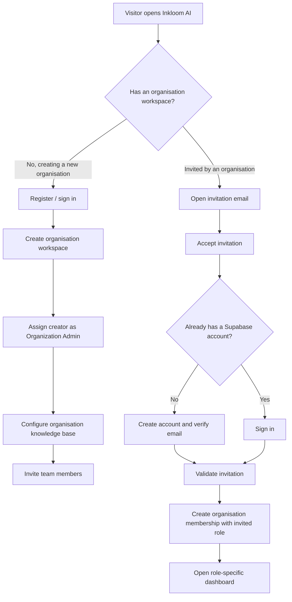

# Inkloom AI – User Onboarding & Email Invitation Specification

**Document type:** Product and technical specification
**Scope:** Organisation workspace creation, team invitations, role assignment, account activation, email delivery and secure workspace membership
**Current application stack:** React frontend on Firebase Hosting, Node.js backend on Render, Supabase Auth and PostgreSQL
**Recommended email provider:** Resend, connected to Supabase Auth using custom SMTP
**Status:** Finalised design for the MVP, with production safeguards identified
**Prepared:** 30 October 2026

---

## 1. Purpose

This document defines how users enter and work within an Inkloom AI organisation workspace.

Inkloom uses an invitation-based membership model:

- The first user registers and creates an organisation workspace.
- That user becomes the first **Organization Admin**.
- The Admin invites employees, managers and authorised reviewers by email.
- The Admin assigns each invitee a workspace role.
- Invitees accept the invitation and either create a Supabase Auth account or sign in to an existing account.
- After acceptance, the user receives access to the organisation workspace according to the assigned role.

The system must support multiple organisations and must keep each organisation's workspace, brand knowledge, advertisements, findings and review history isolated from other organisations.

## 2. Final user roles

Inkloom has four workspace roles. These are permissions assigned to a user within an organisation, not necessarily four different people.

| Role | Primary responsibility | Main permissions |
|---|---|---|
| Organization Admin | Creates and manages the organisation workspace | Manage workspace settings, organisation knowledge base, members, invitations and role assignments |
| Content Creator | Submits and revises advertisements | Upload advertisements, view findings, revise and resubmit own or permitted submissions |
| Approver (Manager) | Makes the final organisational approval decision | Review submissions, approve, request changes or reject according to workflow permissions |
| Governance Reviewer | Resolves uncertain or ambiguous findings | Review escalated findings, record decisions and explanations, and return findings for correction or further review |

### 2.1 Role-specific boundaries

**Organization Admin**
- Is the first user in a newly created organisation workspace.
- Manages workspace membership and the organisation's four knowledge-base categories.
- Can invite additional Admins, Creators, Approvers and Governance Reviewers.
- Can deactivate or revoke a member's workspace access.
- Does not automatically need to approve every advertisement.

**Content Creator**
- Cannot create a new organisation workspace on behalf of an existing organisation unless explicitly given that capability in a future product version.
- Cannot assign themselves another role.
- Can upload, track, revise and resubmit advertisements.

**Approver (Manager)**
- Receives advertisements that are ready for organisational approval, including items returned from an uncertainty review where appropriate.
- Records an approval, rejection or change request.
- An approval is an internal organisation decision; it is not a statement that Inkloom has independently certified legal compliance.

**Governance Reviewer**
- Handles ambiguous or low-confidence findings that automated checks cannot reliably classify.
- Records the decision and rationale.
- Does not silently override or delete the original AI finding.
- A reviewer decision is retained in the audit trail and can be considered in future governance insights.

### 2.2 One person can hold more than one role

A small organisation may have one person acting as both Organization Admin and Approver. The product should support more than one role for a person where required, or a clearly defined combined permission set.

For the MVP, the simpler implementation is one primary role per organisation membership. If an individual needs multiple responsibilities, the Admin can assign the highest appropriate combined role only where the permission model explicitly supports it. Do not let the frontend infer privileges from a job title.

A user's role is always scoped to a specific organisation. A person may be a Content Creator in Organisation A and an Approver in Organisation B.

---

## 3. Onboarding overview

There are two onboarding paths:

1. **Organization Admin self-registration:** the first user creates the organisation workspace.
2. **Invited member onboarding:** other employees join through an invitation sent by an Admin.



---

## 4. Organization Admin onboarding – create a workspace

### 4.1 Registration screen

The first user selects **Create Organisation** from the Inkloom landing page.

Minimum account fields:

| Field | UI control | Required | Example |
|---|---|---:|---|
| Full name | Text input | Yes | Keerthi Kumar |
| Work email | Email input | Yes | admin@freshsip.com |
| Password | Password input or supported SSO | Based on auth method | User enters password |
| Confirm password | Password input | For password registration | User confirms password |

The user must verify their email if email confirmation is enabled in Supabase Auth. Do not create a fully active organisation membership before the account is verified.

### 4.2 Workspace creation screen

After successful authentication, the first user creates the organisation workspace.

| Field | UI control | Required | Example |
|---|---|---:|---|
| Organisation name | Text input | Yes | Freshsip Foods Pvt. Ltd. |
| Workspace name / slug | Generated editable text | Yes | freshsip |
| Industry | Dropdown with custom option | Recommended | Food & Beverage |

The workspace slug must be unique. The application should normalise it and validate it before saving.

### 4.3 Assign the first Admin

On successful workspace creation:

1. Create the organisation record in Supabase PostgreSQL.
2. Create a membership record for the authenticated user.
3. Assign the `organization_admin` role.
4. Mark the membership as active.
5. Record the creator as the workspace creator and first Admin.
6. Redirect the user to the organisation setup dashboard.

The first Admin then configures the organisation knowledge base using the separate **Organisation Input Specification**:

1. Brand Guidelines – structured form.
2. Product / Service Information – Excel workbook.
3. Approved / Restricted Claims – Excel workbook.
4. Approved Brand Assets – central asset library.

This document does not redefine those fields. It defines who can configure them and how other users obtain workspace access.

---

## 5. Inviting other users – Admin workflow

### 5.1 Team Management page

The Admin opens:

**Workspace Settings → Team Management → Invite User**

The invitation form contains only the necessary information.

| Field | UI control | Required | Example |
|---|---|---:|---|
| Employee name | Text input | Yes | Rahul Kumar |
| Email address | Email input | Yes | rahul@freshsip.com |
| Workspace role | Dropdown | Yes | Content Creator |

Available roles:
- Content Creator
- Approver (Manager)
- Governance Reviewer
- Organization Admin

The Admin clicks **Send Invitation**.

### 5.2 What the system does

1. Verify the caller's Supabase access token on the Node.js backend.
2. Confirm that the caller has the `organization_admin` permission in the specified workspace.
3. Validate the email address and requested role.
4. Check whether the email already has an active or pending membership in this workspace.
5. Create a pending organisation invitation record.
6. Start the appropriate email/invitation flow (see Section 7).
7. Show the Admin the invitation status.

The backend must not trust an `organization_id`, `role` or `invited_by` value merely because it came from the browser. It must validate the authenticated Admin's membership and permissions server-side.

### 5.3 Team Management statuses

The Admin should be able to see:

| Status | Meaning | Admin action |
|---|---|---|
| Pending | Invitation created and awaiting acceptance | Resend or revoke |
| Accepted | Invitee joined the workspace | Change role or deactivate |
| Expired | Invitation passed its expiry time | Send a new invitation |
| Revoked | Admin cancelled the invitation | Send a new invitation if needed |
| Delivery failed | Email provider reported a send failure | Retry after resolving the cause |

Do not show an invitation as successfully sent merely because the invitation record was created. Record provider send success/failure separately from acceptance status.

---

## 6. Invitee onboarding

### 6.1 Invitation email received

The invitee receives an email containing:
- Organisation name.
- Name of the person who invited them, where available.
- Assigned workspace role.
- A secure **Accept Invitation** link.
- Invitation expiry information.
- A note that the link is intended only for the invited email address.

### 6.2 Invitee opens the invitation

The link opens the configured Inkloom frontend URL hosted on Firebase Hosting.

The application checks the invitation state and then handles one of two account conditions:

**New user:**
1. The invitee completes the Supabase Auth invitation/sign-up flow.
2. The invitee verifies/activates the account using the Supabase invitation link.
3. The user is redirected to the configured Inkloom callback page.
4. Inkloom validates the pending workspace invitation.
5. Inkloom creates the organisation membership with the role assigned by the Admin.
6. The invitee lands on the appropriate role-specific dashboard.

**Existing user:**
1. The invitee clicks the workspace invitation link.
2. If not already signed in, the invitee signs in to the existing Inkloom account.
3. The backend verifies that the authenticated account's verified email matches the invitation email.
4. The invitee accepts the workspace invitation.
5. Inkloom creates the new organisation membership with the role assigned by the Admin.
6. The invitee can switch to the newly joined organisation workspace.

An existing user should not be forced to create a second account. One Supabase Auth account may belong to several organisation workspaces, with a separate role in each workspace.

---

## 7. Email delivery architecture – Supabase + Resend

### 7.1 Final decision

Use:

- **Supabase Auth:** authentication, user accounts and new-user invitation links.
- **Supabase PostgreSQL:** organisation invitations, memberships and role assignments.
- **Resend:** transactional email delivery.
- **Supabase custom SMTP:** connects Supabase Auth email delivery to Resend.
- **Node.js on Render:** trusted server that authorises invitation requests and calls Supabase Admin APIs / Resend API as appropriate.
- **Firebase Hosting:** hosts the React frontend and invitation acceptance pages.

The recommended arrangement for new-user invitations is:

```text
Organization Admin
       |
       v
React frontend (Firebase Hosting)
       |
       v
Node.js backend (Render)
       |
       |-- Authorise Admin and create pending organisation invitation
       |
       v
Supabase Auth Admin API: inviteUserByEmail()
       |
       v
Supabase Auth email service
       |
       |  Custom SMTP configured to Resend
       v
Resend SMTP relay
       |
       v
Invitee's email inbox
       |
       v
Firebase-hosted Inkloom invitation callback
       |
       v
Node.js backend validates invitation and creates membership
```

### 7.2 Why Supabase's default email sender is not enough

Supabase's built-in email sender is intended for development/testing, not production. Its current documented restrictions include sending only to pre-authorised addresses and a default limit currently set to 2 emails per hour. Supabase recommends configuring custom SMTP for production use.

Therefore, configure a custom SMTP provider rather than relying on the default Supabase sender.

Official reference: [Supabase – Send emails with custom SMTP](https://supabase.com/docs/guides/auth/auth-smtp)

### 7.3 Why Resend

Resend supports SMTP and is listed by Supabase as a supported custom SMTP provider. The Supabase partner integration can assist with connecting Resend and configuring the Auth SMTP settings.

Official references:
- [Supabase – Resend integration](https://supabase.com/partners/resend)
- [Resend SMTP service](https://resend.com/changelog/smtp-service)
- [Resend pricing](https://resend.com/pricing)

The Resend pricing page currently lists a Free plan with:
- 3,000 emails per month.
- 100 emails per day.
- Up to 3 domains.

These limits and plan conditions can change. Check the provider's pricing page before production launch. The free tier is suitable for an MVP with modest invitation and transactional email volume, but it is not an unlimited email service.

### 7.4 Resend SMTP settings

Resend's documented SMTP settings include:

| Setting | Value |
|---|---|
| SMTP host | `smtp.resend.com` |
| Port | `465` (SSL) |
| Username | `resend` |
| Password | Resend API key |
| Sender | A verified sender address on the configured domain |

Use the current Resend dashboard and documentation for the exact settings supported by the account. Keep the API key secret.

### 7.5 Configure custom SMTP in Supabase

Recommended setup sequence:

1. Create a Resend account.
2. Add a sending domain or authentication subdomain owned by the organisation/application.
3. Verify domain ownership in Resend.
4. Add the required DNS records, including SPF and DKIM. Configure DMARC as appropriate for the sending domain.
5. Create a Resend API key with only the permissions needed for sending.
6. In Supabase, open the project's Authentication email/SMTP settings.
7. Enable custom SMTP and enter Resend's SMTP host, port, username, password/API key and sender details.
8. Configure the sender display name, for example `Inkloom AI`.
9. Configure the email templates, especially the **Invite user** template.
10. Add the production Firebase Hosting URL and required callback paths to Supabase's allowed redirect URLs.
11. Send test invitations to controlled test inboxes and verify delivery, link routing and account activation.

Supabase's custom SMTP documentation states that a new custom SMTP configuration is initially subject to a conservative Auth rate limit (currently documented as 30 messages/hour), which can be adjusted through Auth rate-limit settings. Check the current project settings before assuming a higher rate.

Supabase also recommends SPF, DKIM and DMARC configuration to improve email deliverability. Use a dedicated authentication sending subdomain/address where practical, for example `no-reply@auth.example.com`, rather than mixing authentication emails with marketing campaigns.

### 7.6 Important Render clarification

Render's free web services block outbound SMTP traffic on ports 25, 465 and 587. This does **not** prevent the recommended Supabase Auth → Resend SMTP setup, because Supabase Auth's infrastructure—not the Render Node.js service—connects to Resend for those Auth emails.

However, if Node.js on a free Render instance tries to send mail directly using SMTP, it will be blocked on those ports. For any application-generated emails sent by the Render backend, use Resend's HTTPS API, or use a service/plan/network that supports the required SMTP connection.

Official reference: [Render – Free service limitations](https://render.com/docs/free)

---

## 8. New-user invitation vs existing-user workspace invitation

This distinction is essential for a multi-organisation product.

### 8.1 New user – use Supabase Auth invitation

For an email address that does not already belong to a confirmed Supabase Auth user:

1. Node.js creates a pending organisation invitation record.
2. Node.js calls Supabase Auth Admin API `inviteUserByEmail()` using the Supabase secret key on the server.
3. Supabase Auth sends the invitation using the configured Resend custom SMTP provider.
4. `redirectTo` points to the configured Inkloom invitation callback URL.
5. After the invitee completes the Auth flow, Inkloom validates the pending organisation invitation and creates the membership.

Supabase documentation: [Invite users](https://supabase.com/docs/guides/auth/users)

Example server-side call (illustrative):

```javascript
const { data, error } = await supabase.auth.admin.inviteUserByEmail(
  inviteeEmail,
  {
    redirectTo: `${APP_URL}/auth/invitation-callback?invitation_id=${invitationId}`,
    data: {
      // Optional display metadata only.
      // Do not use user_metadata as the source of role permissions.
      display_name: inviteeName
    }
  }
);

if (error) {
  // Record delivery/creation failure and return a safe error to the Admin.
  throw error;
}
```

The Supabase secret key (or legacy service-role key) must only be used in the trusted Node.js environment. Never place it in React, browser code, public environment variables or client-side bundles.

Supabase notes that `redirectTo` must be present in the project's allowed redirect URL list. If it is not allowed, the redirect may fall back to the configured Site URL.

### 8.2 Existing user – use an application-level workspace invitation

Supabase documents that `inviteUserByEmail()` returns an error when the email already belongs to a confirmed user. This is expected: an existing Inkloom user needs to join another organisation, not create another Auth account.

For an existing user:

1. Node.js creates a pending organisation invitation record.
2. Node.js generates a cryptographically secure, random, single-use invitation token.
3. Store only a hash of the token in the database, not the plaintext token.
4. Node.js sends the invitation email using the Resend HTTPS API.
5. The email link opens the Inkloom invitation acceptance page on Firebase Hosting.
6. The invitee signs in to their existing Supabase account if not already authenticated.
7. The backend checks token validity, expiry, revocation status and that the authenticated user's verified email matches the invitation email.
8. The invitee accepts the invitation.
9. In a database transaction, create the organisation membership and mark the invitation as accepted/consumed.

The invitation token must be single-use and expire after a defined period. A reasonable MVP policy is 7 days, configurable by the application. Resending should revoke or supersede the previous token.

This application-level invitation path is used only to grant workspace membership. It must never create or modify a Supabase Auth account by itself.

### 8.3 Why two paths are needed

| Scenario | Correct flow |
|---|---|
| Person has never registered with Inkloom | Supabase Auth `inviteUserByEmail()` + Resend SMTP |
| Person already has a confirmed Inkloom account | App-level workspace invite token + Resend HTTPS API + existing-user sign-in |
| Person already belongs to this workspace | Do not create a duplicate invitation; show current membership |
| Person has an outstanding invitation | Show pending status; allow Admin to resend or revoke according to policy |

Do not solve the existing-user case by asking employees to create duplicate accounts or by disabling email verification.

---

## 9. Database design for invitations and memberships

The following is a recommended logical schema. Adapt names to the existing Inkloom database, but preserve the relationships and security rules.

### 9.1 `organizations`

| Column | Purpose |
|---|---|
| `id` | Primary key |
| `name` | Organisation display name |
| `slug` | Unique workspace slug |
| `created_by` | User ID of first Admin |
| `created_at` | Creation timestamp |
| `status` | Active / Suspended / Archived |

### 9.2 `organization_memberships`

| Column | Purpose |
|---|---|
| `id` | Primary key |
| `organization_id` | Organisation reference |
| `user_id` | Supabase Auth user ID |
| `role` | `organization_admin`, `content_creator`, `approver`, `governance_reviewer` |
| `status` | Active / Deactivated |
| `joined_at` | Membership activation timestamp |
| `invited_by` | Admin user ID, nullable for workspace creator |

Recommended constraint: unique `(organization_id, user_id)`.

### 9.3 `organization_invitations`

| Column | Purpose |
|---|---|
| `id` | Primary key / invitation ID |
| `organization_id` | Organisation receiving the member |
| `email_normalized` | Lowercased/normalised invitation email |
| `invitee_name` | Display name entered by Admin |
| `role` | Role selected by Admin |
| `invited_by` | Admin user ID |
| `status` | Pending / Accepted / Expired / Revoked / Delivery Failed |
| `invitation_method` | `supabase_auth` or `application_token` |
| `token_hash` | Hash for application-level invitation path; null for Supabase Auth path |
| `expires_at` | Invitation expiry timestamp |
| `accepted_at` | Acceptance timestamp |
| `accepted_by_user_id` | Supabase Auth user ID after acceptance |
| `provider_message_id` | Email provider message ID, when available |
| `last_sent_at` | Last email send timestamp |
| `created_at` | Creation timestamp |
| `updated_at` | Last update timestamp |

Recommended constraints and indexes:
- Index `(organization_id, email_normalized, status)`.
- Prevent more than one active pending invitation for the same organisation and email, unless an explicit resend/supersede design is implemented.
- Validate role values against the allowed role set.
- Do not store plaintext invitation tokens.

### 9.4 Role and membership are server-controlled

The organisation membership table is the source of truth for workspace role and access control.

Do not use `auth.users.user_metadata` as the source of permission decisions. Supabase documents that user metadata can be changed by the user and should not be used for security-sensitive authorisation.

Every backend request and database query must enforce organisation membership and role permissions. Use Supabase Row Level Security (RLS) policies for organisation-scoped data.

---

## 10. Suggested backend endpoints

These are suggested routes, not a requirement to use these exact names.

| Method | Endpoint | Purpose | Access |
|---|---|---|---|
| `POST` | `/api/organizations` | Create a workspace and first Admin membership | Authenticated user |
| `GET` | `/api/organizations/:orgId/members` | List workspace members | Admin / authorised role |
| `POST` | `/api/organizations/:orgId/invitations` | Create and send invitation | Organization Admin |
| `GET` | `/api/invitations/:invitationId` | Get safe invitation details | Valid invitation context |
| `POST` | `/api/invitations/:invitationId/accept` | Accept a pending invitation | Authenticated user with matching email |
| `POST` | `/api/organizations/:orgId/invitations/:id/resend` | Resend / rotate invitation | Organization Admin |
| `POST` | `/api/organizations/:orgId/invitations/:id/revoke` | Revoke pending invitation | Organization Admin |
| `PATCH` | `/api/organizations/:orgId/members/:memberId` | Change role or deactivate member | Organization Admin |

### 10.1 `POST /api/organizations/:orgId/invitations` – expected request

```json
{
  "invitee_name": "Rahul Kumar",
  "email": "rahul@freshsip.com",
  "role": "content_creator"
}
```

The server determines the organisation from the route and verifies the authenticated caller's Admin membership. Do not accept `invited_by` from the client.

### 10.2 Example success response

```json
{
  "invitation_id": "inv_12345",
  "organization_id": "org_12345",
  "email": "rahul@freshsip.com",
  "role": "content_creator",
  "status": "pending",
  "delivery_status": "sent",
  "expires_at": "2026-11-06T12:00:00Z"
}
```

Do not return raw invitation tokens, Supabase secret keys, Resend API keys or internal provider credentials.

---

## 11. Email content and templates

### 11.1 Recommended invitation email

**From:** Inkloom AI `<no-reply@auth.your-domain>`
**Subject:** Invitation to join Freshsip on Inkloom AI

```text
Hello Rahul,

You have been invited by [Admin Name] to join Freshsip on Inkloom AI.

Your assigned role: Content Creator

Inkloom AI helps your organisation review advertisements against its approved
brand guidelines, product information, claims and assets before publication.

[Accept Invitation]

This invitation is intended for rahul@freshsip.com and expires on [expiry date].
If you were not expecting this invitation, you can ignore this email.

Regards,
Inkloom AI
```

The email should be short and clearly identify the organisation, invited email address and role.

### 11.2 Customise Supabase Auth invitation template

For new-user invitations sent through Supabase Auth:
- Use Supabase's **Invite user** email template.
- Keep the Supabase-generated confirmation/invitation link intact.
- Include organisation and role details only as display information, not as trusted permission data.
- Redirect to a Firebase-hosted callback URL included in Supabase's allowed redirect URL list.

Supabase template reference: [Supabase – Email templates](https://supabase.com/docs/guides/auth/auth-email-templates)

### 11.3 Existing-user invitation template

For existing-user workspace invitations sent using the Resend API:
- Include the application-level single-use invitation link.
- Do not include a Supabase password or a temporary password.
- Require the invitee to authenticate before membership is added.
- Match the authenticated, verified email address against the invitation record.

---

## 12. Invitation security requirements

These requirements are mandatory, not optional enhancements.

1. **Server-side invitation creation:** Only the Node.js backend can create invitations and assign roles.
2. **Supabase secret key protection:** Store the Supabase secret/service-role key only in Render environment variables or another trusted secret manager. Never expose it in React or Firebase Hosting environment variables that are bundled into the browser.
3. **Resend API key protection:** Keep the Resend API key server-side. The Supabase SMTP password/API key is stored only in Supabase's SMTP settings.
4. **Verified email matching:** The authenticated user's verified email must match the invitation email before membership activation.
5. **Single-use links:** Application-level invitation tokens must be random, hashed at rest, single-use and time-limited.
6. **Role integrity:** The role applied at acceptance must come from the server-side invitation record, not from a request-body field or editable user metadata.
7. **Organisation isolation:** Users must only access organisation data for workspaces in which they have active memberships.
8. **RLS:** Use row-level security for tenant-scoped tables and storage access.
9. **Revocation:** Revoked or expired invitations must not be accepted.
10. **Replay protection:** An accepted invitation cannot be reused to create another membership or change the role.
11. **Audit trail:** Record who invited the user, who accepted, assigned role, timestamps, resends, revocations and role changes.
12. **Abuse protection:** Rate-limit invitation creation and resending; prevent Admins from sending repeated invitations without limits.
13. **No email enumeration:** Do not expose whether an arbitrary email has a Supabase account to unauthorised users. Return safe, generic responses where appropriate.
14. **No automatic legal approval:** Joining the workspace does not make the user or their later approvals a statement of independent legal certification by Inkloom.

---

## 13. Frontend screens required

### 13.1 Public / unauthenticated screens

- Sign in.
- Create account / Create Organisation.
- Email verification / invitation callback.
- Accept workspace invitation.
- Expired, revoked or invalid invitation message.

### 13.2 Organization Admin screens

**Workspace Settings → Team Management**

- Member list.
- Invite User form.
- Role selector.
- Pending invitation list.
- Resend invitation action.
- Revoke invitation action.
- Change member role action.
- Deactivate member action.

### 13.3 Invitee screens

- Invitation details page showing organisation and assigned role.
- Create-account page for new users.
- Sign-in page for existing users.
- Invitation acceptance confirmation.
- Workspace selection/switching when the user belongs to multiple organisations.

### 13.4 Role-specific landing pages

| Role | Landing page |
|---|---|
| Organization Admin | Organisation dashboard / setup checklist |
| Content Creator | Advertisement workspace / My submissions |
| Approver (Manager) | Approval queue |
| Governance Reviewer | Uncertain findings queue |

The frontend may hide unavailable actions for usability, but backend authorisation remains mandatory.

---

## 14. Error handling and edge cases

| Scenario | Expected behaviour |
|---|---|
| Invalid email format | Reject before invitation creation |
| Email already an active member | Show that the person is already a member |
| Pending invitation already exists | Offer resend or revoke; do not create duplicate active invitation |
| Supabase Auth reports confirmed account exists | Use existing-user workspace invitation flow |
| Supabase SMTP delivery failure | Record failure and show Admin a retry option |
| Resend API failure | Keep invitation non-active, record error safely and allow retry |
| Invite link expired | Show expired message and ask Admin to resend |
| Invite revoked | Reject acceptance and show revoked message |
| User signs in with a different email | Do not add membership; ask them to sign in with the invited email or contact Admin |
| User already belongs to another organisation | Allow joining the new organisation without creating a second Auth account |
| Admin changes role before acceptance | Update pending invitation role server-side; email may be resent to clarify the role change |
| Admin revokes invitation after email sent | Mark invitation revoked; acceptance endpoint must reject it |
| User deactivated after joining | Deny further workspace access while preserving historical audit records |

### 14.1 Invitation expiry

Use a defined application policy for application-level invitations, for example 7 days. Supabase Auth invitation-link expiry is controlled by the project's Auth email OTP expiry configuration; Supabase documentation currently states the default is 1 hour. Configure and test this value according to the desired user experience and Supabase project settings.

If an invitation expires, the Admin should be able to send a new invitation. Do not extend or reactivate a consumed token.

---

## 15. End-to-end example – Freshsip

### Initial setup

1. Person A visits Inkloom AI.
2. Person A registers with `admin@freshsip.com`.
3. Person A creates the `Freshsip Foods Pvt. Ltd.` workspace.
4. Inkloom assigns Person A the `organization_admin` role.
5. Person A completes the four organisation knowledge-base sections.

### Invite three employees

The Admin invites:

| Person | Email | Role |
|---|---|---|
| Rahul Kumar | `rahul@freshsip.com` | Content Creator |
| Priya Kumar | `priya@freshsip.com` | Approver |
| Arjun Kumar | `arjun@freshsip.com` | Governance Reviewer |

### Acceptance

- Rahul has no Inkloom account: Supabase Auth invitation is sent through Resend SMTP. Rahul accepts, completes account setup and receives Content Creator membership.
- Priya already has an Inkloom account: the Node.js backend sends a workspace invitation through the Resend HTTPS API. Priya signs in and accepts; the backend adds the Approver membership to her existing account.
- Arjun has no Inkloom account: Supabase Auth invitation is sent through Resend SMTP. Arjun completes account setup and receives Governance Reviewer membership.

All three users enter the Freshsip workspace with their assigned role. None of them creates a separate organisation workspace or a duplicate account.

---

## 16. Implementation checklist

### Phase A – Workspace and membership foundation

- [ ] Implement organisation creation.
- [ ] Automatically assign the creator as the first Organization Admin.
- [ ] Create organisation membership schema.
- [ ] Enforce workspace-scoped role permissions.
- [ ] Configure RLS for organisation-specific data.

### Phase B – Admin team management

- [ ] Build Team Management page.
- [ ] Build Invite User form.
- [ ] Add role selector with the four supported roles.
- [ ] Add invitation and membership status display.
- [ ] Implement resend and revoke actions.

### Phase C – Email service configuration

- [ ] Create Resend account.
- [ ] Verify sending domain.
- [ ] Configure SPF and DKIM DNS records.
- [ ] Configure DMARC where appropriate.
- [ ] Connect Resend to Supabase custom SMTP.
- [ ] Configure Supabase Site URL and allowed redirect URLs.
- [ ] Customise Invite user email template.
- [ ] Test end-to-end delivery to external inboxes.

### Phase D – New-user invitation flow

- [ ] Create pending organisation invitation on the backend.
- [ ] Call Supabase `inviteUserByEmail()` from Node.js.
- [ ] Handle Supabase invitation errors.
- [ ] Implement Firebase-hosted auth callback.
- [ ] Validate invitee email and pending invitation.
- [ ] Create membership only after successful acceptance.

### Phase E – Existing-user invitation flow

- [ ] Detect/handle the confirmed-user case safely.
- [ ] Generate single-use application invitation tokens.
- [ ] Store only token hashes.
- [ ] Send invitation through Resend HTTPS API.
- [ ] Implement authenticated acceptance endpoint.
- [ ] Check verified email equality, expiry and revocation.
- [ ] Create membership transactionally and consume the token.

### Phase F – Security and acceptance tests

- [ ] Verify that a Creator cannot invite users.
- [ ] Verify that a user cannot assign themselves Admin permissions.
- [ ] Verify that a user cannot accept an invite addressed to another email.
- [ ] Verify that expired and revoked invites fail.
- [ ] Verify that duplicate memberships are prevented.
- [ ] Verify that one account can join multiple organisations.
- [ ] Verify role-specific dashboards and API permissions.
- [ ] Verify that deactivated users lose access.
- [ ] Verify that historical review records remain intact after deactivation.
- [ ] Verify that invitation secrets never appear in browser code or logs.
- [ ] Verify email delivery, bounce and provider failure handling.

---

## 17. Cost and free-tier considerations

The chosen software flow can be implemented without buying a separate email platform subscription for a modest MVP, but free tiers have quotas and conditions.

### Resend

The Resend pricing page currently lists a Free plan with 3,000 emails per month and a daily limit of 100 emails. These are provider limits, not a promise of unlimited or guaranteed delivery. Monitor usage and check current pricing before launch.

Pricing: https://resend.com/pricing

### Supabase

Supabase Auth's default email sender is not suitable for sending invitations to arbitrary external users in production. It is restricted to pre-authorised addresses and currently documents a 2 emails/hour limit. Use custom SMTP for real invitations.

Documentation: https://supabase.com/docs/guides/auth/auth-smtp

### Render

Render free web services block outbound SMTP ports 25, 465 and 587. This does not block Supabase Auth from connecting to Resend using Supabase's configured SMTP. It does mean a Node.js application on a free Render service should use Resend's HTTPS API rather than trying to send SMTP directly.

Documentation: https://render.com/docs/free

### Other infrastructure

Firebase Hosting, Supabase database/auth/storage and Render hosting have their own quotas, usage limits and free-tier restrictions. Email being free within Resend's allowance does not make the whole Inkloom platform cost-free.

---

## 18. Final decisions to preserve

1. Inkloom has four workspace roles: Organization Admin, Content Creator, Approver (Manager) and Governance Reviewer.
2. The first user self-registers, creates the organisation workspace and automatically becomes its first Admin.
3. All other users join through Admin-issued email invitations.
4. The Admin selects the invitee's role before sending the invitation.
5. An invitee can create a new account or sign in to an existing account.
6. One Supabase Auth account can belong to multiple organisation workspaces with different roles per workspace.
7. Use Supabase Auth for authentication and new-user invitations.
8. Use Resend as the email provider through Supabase custom SMTP.
9. Use an application-level secure invitation token sent through Resend's HTTPS API for an existing confirmed Supabase user joining another workspace.
10. Keep organisation invitation records and role assignments in Supabase PostgreSQL; never trust browser-provided roles or editable user metadata for permissions.
11. Keep Supabase secret keys and Resend API keys out of the frontend.
12. Enforce organisation isolation using backend authorisation and Supabase RLS.
13. Record invitation, acceptance, revocation, role-change and deactivation events in the audit trail.

**Final architecture:** Admin creates workspace → Admin invites users → Supabase Auth / application invitation flow sends email via Resend → invitee verifies or signs in → backend validates invitation → membership is created with the Admin-assigned role → user enters the role-specific workspace.

---

## 19. Official references

1. [Supabase – Send emails with custom SMTP](https://supabase.com/docs/guides/auth/auth-smtp)
2. [Supabase – Inviting users](https://supabase.com/docs/guides/auth/users)
3. [Supabase – Email templates](https://supabase.com/docs/guides/auth/auth-email-templates)
4. [Supabase – Resend integration](https://supabase.com/partners/resend)
5. [Resend – Pricing](https://resend.com/pricing)
6. [Resend – SMTP service and credentials](https://resend.com/changelog/smtp-service)
7. [Render – Free service limitations](https://render.com/docs/free)

Provider limits, pricing, defaults and API behaviour can change. Recheck the official documentation and project dashboards when implementing or deploying this specification.
